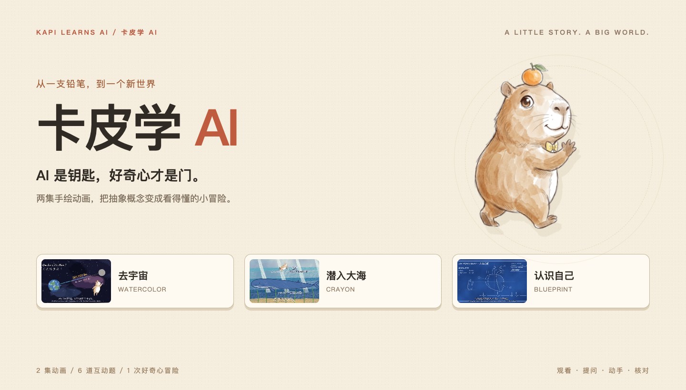
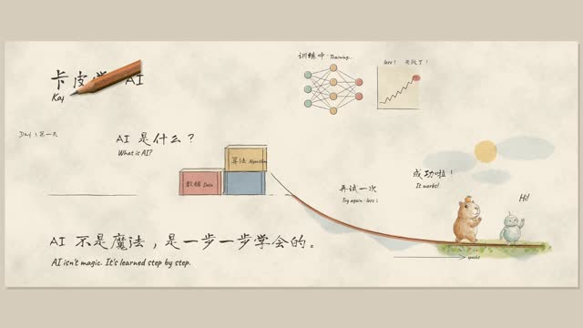
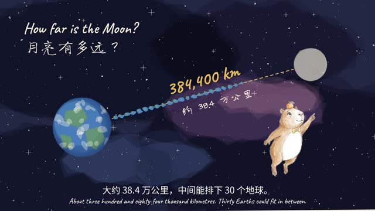
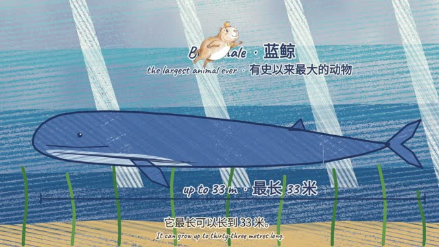
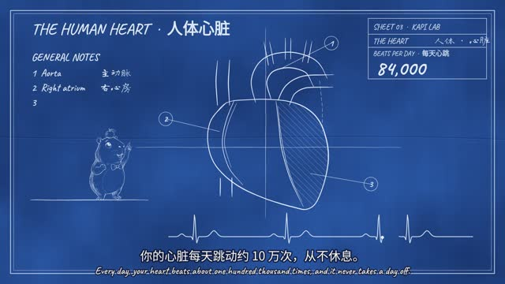
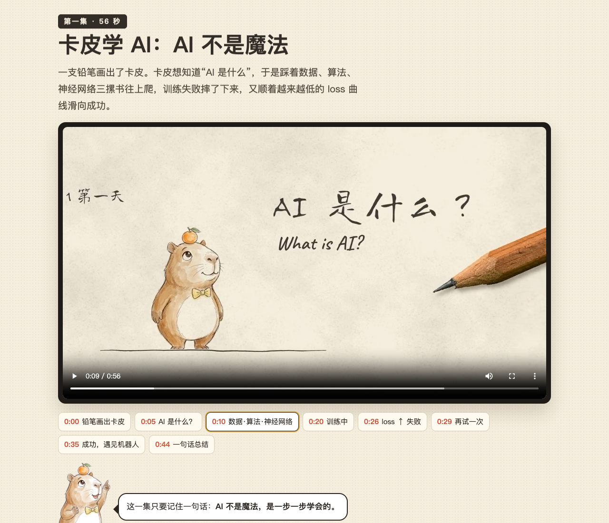
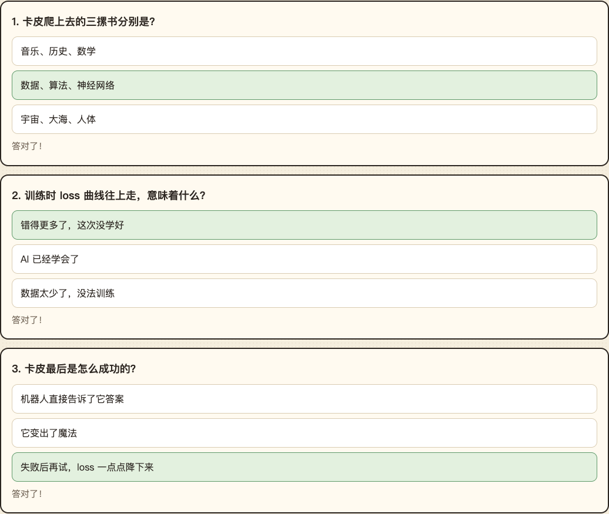

<div align="center">

# 🍊 卡皮学 AI

### AI 是钥匙，好奇心才是门。

跟着头顶橘子的卡皮巴拉，把抽象的 AI，变成看得懂的小故事。

**2 集动画 · 6 道互动题 · 1 次好奇心冒险**

[认识卡皮](#一只卡皮巴拉两次小冒险) · [画面抢先看](#每一扇门都是一个新世界) · [开始体验](#把卡皮带进你的课堂)

</div>



如果第一次认识 AI，不是从一页术语开始，而是从一只卡皮巴拉的冒险开始呢？

一支铅笔画出卡皮，三摞书搭起学习的阶梯，一条起伏的曲线记录失败与重来。等它终于认识了机器人朋友，新的故事才刚刚开始：一把金钥匙，打开宇宙、大海和人体的门。

**卡皮学 AI**是一份可以在浏览器中打开的中文互动动画课件。它把故事、画面、知识卡片和小测验放在同一页，让 AI 入门多一点想象，也多一次亲手探索。

> 第一集，理解“怎么学会”。第二集，发现“为什么想学”。

## 一只卡皮巴拉，两次小冒险

<table>
<tr>
<td width="50%" valign="top">

### 01 · AI 不是魔法



**从失败，到再试一次。**

卡皮踩着“数据、算法、神经网络”往上爬，经历训练失败，又沿着逐渐降低的 loss 曲线走向成功。

用一个小故事，认识数据、算法、神经网络、loss 和训练。

`约 56 秒` · `钢笔淡彩` · `无旁白 / 手写中英字`

[打开第一集课件](index.html#ep1) · [查看动画文件](assets/media-03.mp4)

</td>
<td width="50%" valign="top">

### 02 · 打开新世界



**从得到答案，到学会提问。**

机器人朋友送来一把金钥匙。卡皮穿过水彩宇宙、蜡笔大海和蓝图人体，最后接过铅笔，画自己的门。

让好奇心带路，用 AI 探索知识，再核对答案的来源。

`约 2 分钟` · `多种手绘画风` · `英文旁白 / 中英字幕`

[打开第二集课件](index.html#ep2) · [查看动画文件](assets/media-10.mp4)

</td>
</tr>
</table>

> GitHub 文件预览不会运行 HTML 课件。请下载整个项目后打开 `index.html`；动画文件也可单独下载观看。

## 每一扇门，都是一个新世界

<table>
<tr>
<td width="33%"></td>
<td width="33%"></td>
<td width="33%"></td>
</tr>
<tr>
<td align="center"><strong>水彩宇宙</strong><br>把目光，投向更远的地方。</td>
<td align="center"><strong>蜡笔大海</strong><br>让问题，潜入更深的世界。</td>
<td align="center"><strong>蓝图人体</strong><br>从自己身上，发现新的好奇。</td>
</tr>
</table>

### 不只看一遍，还能停下来想一想



| 体验 | 课件里有什么 |
| :--- | :--- |
| 🎬 看故事 | 两集内置 MP4 动画，支持播放、暂停和拖动进度 |
| ⏱ 按章节回看 | 点击时间按钮，直接跳到想讲的片段 |
| 🗂 把概念留住 | 图文卡片串起数据、算法、神经网络与训练 |
| 💡 做题看反馈 | 两集各 3 题，答题后显示正确选项与反馈，累计总分 |
| ✏️ 自己动手 | “画一扇你自己的门”：提出问题、画出猜想、向 AI 提问并核对 |
| 🎒 带走就能用 | 原生 HTML / CSS / JavaScript；图片与动画随项目提供 |



答题状态保存在当前页面内存中，刷新后重置。每题提交一次后锁定，适合边看边讨论。

## 把卡皮带进你的课堂

### 下载即用

1. 点击仓库页面的 **Code → Download ZIP**，下载并解压整个项目。
2. 双击根目录的 **`index.html`**，用浏览器打开。
3. 先看动画，再点章节回看，最后做题与画门。

请保持 `index.html` 与 `assets/` 的相对位置。媒体均为本地文件，课件无需联网、账号或 API Key。

也可以在项目目录启动本地服务（需已安装 Python 3）：

```bash
python3 -m http.server 8000 --bind 127.0.0.1
```

随后访问 <http://127.0.0.1:8000>。

Python 简易服务器适合页面预览；视频章节跳转建议直接打开本地文件，或使用支持 HTTP Range 的静态托管服务。

### 一次轻量的课堂安排

| 环节 | 建议用时 | 可以这样带领 |
| :--- | :--- | :--- |
| 看两集动画 | 约 3 分钟 | 先跟着故事走，留住最感兴趣的画面 |
| 停下来讨论 | 约 5 分钟 | 卡皮为什么失败？你会怎样解释“训练”？ |
| 完成小测验 | 约 3 分钟 | 选出答案，说说理由；有疑问就按章节回看 |
| 画自己的门 | 约 5–10 分钟 | 写一个真问题，画出猜想，再寻找可靠来源 |

以上是使用建议，可按课堂节奏调整；也适合亲子共学和 AI 入门分享。

## 简单，也方便继续创作

```text
kapi-learns-ai/
├── index.html                 # 完整互动课件
├── assets/                    # 原课件提取的图片和两集动画
├── README.md                  # 项目介绍
└── docs/
    ├── images/                # GitHub 展示封面与实机截图
    ├── showcase.html          # 封面排版源文件
    ├── SOURCES.md             # 素材来源与使用边界
    ├── VERIFICATION.md        # 本地验证记录
    └── media-manifest.json    # 素材大小与 SHA-256 清单
```

内容、样式与交互集中在 `index.html`，没有构建步骤或第三方运行依赖。可以从改一句提问、替换一张知识卡片开始。

## 关于素材与署名

本项目根据用户提供的《卡皮学AI课件.html》整理。原课件署名：**动画由 lemo-opuscar 用代码绘制，角色姿势图为 AI 生成**。本次整理保留原课件的动画、内容与交互，将内嵌媒体提取为独立文件，并制作项目展示材料。

课件列出的知识来源为 NASA、NOAA Fisheries 和 British Heart Foundation；详细说明见 [素材来源](docs/SOURCES.md)。本项目尚未指定开源许可证，公开展示不代表授予素材的再分发或商业使用许可。

---

<div align="center">


**明天，你想打开哪一扇门？**

如果这个小故事让你想到了一次有趣的课堂，欢迎点一颗 ⭐，也欢迎分享你的“门”。

</div>
